# Awesome-Git-Utilities-Visual-DIFF-Tools


  





  
  
  
  
  



# 👁️ Top Git Utilities & Visual Diff Tools

**Curated List of SaaS/Commercial Platforms & Open-Source GitHub Projects**  
*Focused on Visual 2-Way/3-Way Diff & Merge GUIs (Meld, KDiff3, WinMerge, Diffuse), Interactive Visual Diff Viewers (Munder-Difflin, diff2html, GitButler), Terminal Side-by-Side Pagers (Delta, Difftastic) & Editor Merge Interfaces*  
**Last updated: November 2026**

This repository tracks notable **SaaS/Commercial platforms** and **open-source projects** for **Git Utilities & Visual Diff Tools**. These tools power visual side-by-side 2-way and 3-way file/directory comparison and conflict merging (`Meld`, `KDiff3`, `WinMerge`, `Diffuse`), interactive visual diff inspection (`HarnessMD/munder-difflin`, `diff2html`, `GitButler`, `GitHub Desktop`), syntax-highlighted and AST-aware terminal side-by-side diff viewers (`delta`, `Difftastic`, `icdiff`, `ydiff`), and IDE/editor merge resolution (`Diffview.nvim`, `Ediff`, `Magit`) for software engineers and technical writers.

**Examples** include GitKraken Diff (GitKraken), P4Merge (Perforce Software), Sublime Merge (Sublime HQ), Beyond Compare (Scooter Software), Kaleidoscope (Letter Opener), Araxis Merge (Araxis), DeltaWalker (Deltopia), DiffMerge (SourceGear), Meld (GNOME / Cross-Platform Builds), and KDiff3 (KDE / Cross-Platform Builds) (the category leaders).

**🚀 Open-source emphasis**: This section is heavily expanded with every major active project for visual 2-way/3-way diff & merge GUIs (`Meld`, `KDiff3`, `WinMerge`, `Diffuse`, `TkDiff`), interactive visual diff apps & web viewers (`HarnessMD/munder-difflin`, `diff2html`, `GitButler`, `GitHub Desktop`, `GitExtensions`), terminal side-by-side & structural diff pagers (`delta`, `Difftastic`, `icdiff`, `ydiff`, `diff-so-fancy`), and editor/TUI diff interfaces (`Lazygit`, `Diffview.nvim`, `vimdiff`, `Ediff`) — ideal for engineers replacing $70–$289 commercial diff/merge licenses with free, cross-platform open-source software.

🤝 Contributions welcome! Open a PR to add/update entries. Keep descriptions factual and link to official sites.

## 📑 Table of Contents
- [📊 Sector Overview & Market Dynamics](#-sector-overview--market-dynamics)
- [☁️ SaaS/Hosted & Commercial Platforms](#️-saashosted--commercial-platforms)
- [💻 Open-Source GitHub Projects](#-open-source-github-projects)
- [🛠️ How to Contribute](#️-how-to-contribute)
- [⚠️ Disclaimer](#️-disclaimer)
- [💖 Support & Thank You](#-support--thank-you)

## 📊 Sector Overview & Market Dynamics

The global Developer Productivity, Version Control & Code Comparison Tooling market is valued at approximately **$14.5B–$18.2B+ in 2026**, expanding at a ~18%–23% CAGR propelled by AI coding-agent patch verification, complex monorepo 3-way merges, and visual diff review workflows. While commercial visual diff/merge utilities (**Beyond Compare, Kaleidoscope, Araxis Merge, Sublime Merge, DeltaWalker**) remain popular among enterprise teams, the **cross-platform visual 3-way merge GUI, browser diff renderer, and terminal side-by-side pager ecosystems are overwhelmingly powered by open-source software** (`Meld`, `KDiff3`, `WinMerge`, `delta`, `Difftastic`, `diff2html`, `GitButler`).

## ☁️ SaaS/Hosted & Commercial Platforms

*Sorted descending by company valuation / annual revenue scale.*

| Platform | Description | Company Scale (Valuation / Revenue) | Starting Paid Tier | Free Tier / Trial Limit |
| :--- | :--- | :--- | :--- | :--- |
| **[P4Merge (Perforce Software)](https://perforce.com)** | Free standalone visual 3-way file merge and image comparison tool by Perforce usable directly as a `git difftool` and `git mergetool`. | **Part of Perforce Software** (~$500M+ annual revenue; backed by Francisco Partners) | **$0 / Free Proprietary Tool** (Part of Perforce Helix Core visual client suite) | **100% Free Forever** (Unlimited personal and commercial 3-way text/code/image visual diff and merge on Windows, macOS & Linux) |
| **[GitKraken Diff (GitKraken Client)](https://gitkraken.com)** | Visual desktop Git GUI and CLI featuring an interactive 3-way merge conflict editor, word-level inline/split diffs, and GitHub/Jira PR diffs. | **~$50M–$100M Est. Valuation** (~$20M+ est. ARR; >30M developers; acquired GitLens) | **$4.95 / user / month** billed annually (Pro tier for private cloud repos & Workspaces) | **Forever Free Plan** (100% free for **local and public cloud repositories**; paid plan required for private cloud repositories) |
| **[Sublime Merge (Sublime HQ)](https://sublimemerge.com)** | High-performance native C++ Git client from the makers of Sublime Text featuring blazing-fast line/hunk staging, 3-way merge tool, and syntax diffs. | **Bootstrapped Australian Software Studio** (Profitable creators of Sublime Text) | **$99 one-time** personal license (includes 3 years of updates) or **$75 / seat / year** for business | **Unlimited Evaluation Trial** (Free download with no hard time cutoff and occasional purchase prompts; perpetual license removes prompt) |
| **[Beyond Compare (Scooter Software)](https://scootersoftware.com)** | Gold-standard commercial folder, file, source-code, CSV/data, and 3-way merge comparison utility across Windows, macOS, and Linux. | **Bootstrapped US Software Vendor** (Profitable 25+ year developer-tools company) | **$35 one-time** Standard license or **$70 one-time** Pro license (adds 3-way merge & folder sync) | **30-Day Full-Access Free Trial** (30 actual days of active use—not calendar days—with full Pro 3-way merge features) |
| **[Araxis Merge (Araxis)](https://araxis.com)** | Enterprise 2-way and 3-way visual file comparison, merging, and folder synchronization suite for Windows and macOS supporting code, Office, PDF, and images. | **Bootstrapped UK Software Vendor** (Profitable 30+ year developer-tools company) | **$129 one-time** Standard edition or **$289 one-time** Professional edition (adds 3-way visual merge) | **30-Day Full-Access Free Trial** (Complete Professional edition evaluation on Windows and macOS for 30 days) |
| **[Kaleidoscope (Letter Opener)](https://kaleidoscope.app)** | Native macOS visual diff and 3-way merge application comparing text, source code, images, PDFs, and folders with deep Xcode and Git integration. | **Bootstrapped Independent Mac Studio** (Letter Opener GmbH; German Mac software vendor) | **$8.00 / month** billed annually ($96/yr) or **$199 one-time** perpetual macOS license | **14-Day Full-Access Free Trial** (Full text, image, folder, and 3-way merge functionality on macOS for 14 days) |
| **[DeltaWalker (Deltopia)](https://deltawalker.com)** | Cross-platform visual 2-way and 3-way file, folder, archive, XML/JSON, and image comparison and merge tool for macOS, Windows, and Linux. | **Bootstrapped US Software Vendor** (Deltopia Inc.; specialized visual diff vendor) | **$39.95 one-time** Standard license or **$69.95 one-time** Oro (Pro) license with 3-way merge | **10-Day Full-Access Free Trial** (Complete 2-way and 3-way visual comparison and merge capabilities during 10-day trial) |
| **[DiffMerge (SourceGear)](https://sourcegear.com)** | Cross-platform GUI application for visually comparing and merging files and folders across Windows, macOS, and Linux with intra-line highlighting. | **Bootstrapped US Software Vendor** (SourceGear LLC; developer tools provider) | **$0 / Free Proprietary Software** (Freeware binary distribution with zero seat fees) | **100% Free Forever** (Unlimited personal and commercial 2-way diffing, folder comparison, and 3-way file merging) |
| **[Meld (GNOME / Cross-Platform Builds)](https://meldmerge.org)** | Widely distributed visual 2-way and 3-way diff and merge desktop tool pre-packaged across Linux distros, Homebrew macOS, and Windows installers. | **Community Open-Source Project** (GPL-2.0+; GNOME ecosystem flagship diff tool) | **$0 / Free Open-Source** (Zero licensing, subscription, or telemetry costs) | **100% Free Forever** (Unlimited side-by-side file diffs, 3-way merge conflict resolution, and directory tree comparisons) |
| **[KDiff3 (KDE / Cross-Platform Builds)](https://kde.org)** | Cross-platform KDE visual 2-way and 3-way file/directory comparison and automatic merge tool for Linux, Windows, and macOS. | **Community Open-Source Project** (GPL-2.0+; KDE e.V. open-source ecosystem) | **$0 / Free Open-Source** (Zero licensing or seat costs across all desktop operating systems) | **100% Free Forever** (Unlimited character-by-character 3-way merges, whitespace heuristics, and automated conflict resolution) |

## 💻 Open-Source GitHub Projects

| Project | License / Hosting Cost | Free Tier / Self-Hosted Limit | Description |
| :--- | :--- | :--- | :--- |
